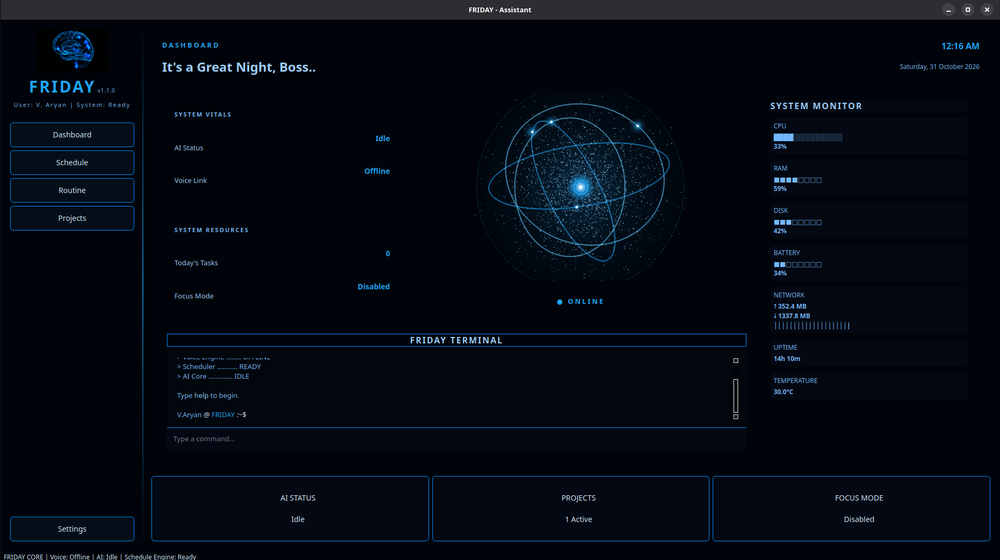
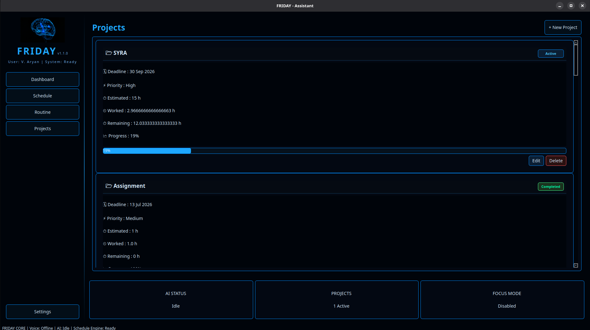

# FRIDAY
### Focused Routine Intelligence and Daily Activity Yardstick

<p align="center">
  A personal productivity and schedule management system designed to organize daily routines, manage projects, and track activities.
</p>

<p align="center">
  
</p>

<p align="center">
  <strong>Organize your day. Manage your projects. Stay focused.</strong>
</p>

---

## Overview

**FRIDAY (Focused Routine Intelligence and Daily Activity Yardstick)** is a personal schedule and productivity management application developed to bring daily activities, routines, and project management into one organized workspace.

It is designed to help users structure their schedules, manage ongoing projects, monitor activities, and maintain a clearer overview of their daily responsibilities.

FRIDAY is developed as an independent application with the potential to become part of the broader **SYRA/SAIRA assistant ecosystem**.

## Interface Preview

### Dashboard

The dashboard provides an overview of the user's workspace, helping organize and monitor daily activities from a central interface.

<p align="center">
  
</p>

### Project Management

The project management interface provides a dedicated space for organizing and managing projects.

<p align="center">
  
</p>

## Core Objectives

- **Daily Scheduling:** Organize daily activities and maintain a structured routine.
- **Project Management:** Manage multiple projects and keep track of their progress.
- **Activity Organization:** Keep tasks and responsibilities organized.
- **Productivity Tracking:** Maintain a clearer overview of daily activities.
- **Assistant Ecosystem Integration:** Establish a foundation for potential integration with SYRA/SAIRA.

## Features

The application is being developed around two primary areas:

| Module | Purpose |
|---|---|
| Dashboard | Central overview of the workspace and activities |
| Project Management | Organizing and managing projects |

Additional capabilities will be documented as they are verified in the application.

## Technology Stack

The technology stack and dependencies will be documented here based on the actual project implementation.

## Installation

Installation instructions will be provided according to the project's current environment and dependencies.

## Project Structure

```text
FRIDAY/
├── assets/
│   └── images/
│       ├── dashboard.png
│       └── project.png
├── README.md
├── DEVELOPMENT_LOG.md
└── src/
```

*The structure above illustrates the documentation and asset organization. The actual source directory structure may contain additional files and modules.*

## Development

FRIDAY is an evolving software project. Its development focuses on building a practical, organized, and extensible productivity management system.

For historical development records, implementation checkpoints, build logs, and day-by-day progress, see:

**[DEVELOPMENT_LOG.md](DEVELOPMENT_LOG.md)**

## Future Direction

Potential future development directions include:

- More comprehensive routine and schedule management.
- Improved task and project tracking.
- Activity summaries and productivity insights.
- Smart reminders and notifications.
- Integration with the SYRA/SAIRA assistant ecosystem.

These are development directions, not claims about currently implemented functionality.

## Project Status

**Development:** Ongoing

FRIDAY is under development, and its features and architecture may evolve as the project progresses.

## Ecosystem

FRIDAY is an independent project within the broader personal AI and automation ecosystem associated with SYRA/SAIRA.

## License

License information will be added according to the project's selected distribution terms.
